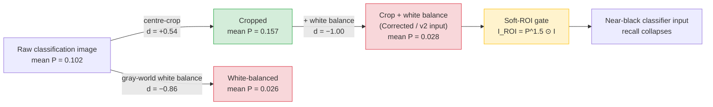

# When More Preprocessing Hurts

**Distribution shift and failure of segmentation-guided colorectal polyp classification**

Pravin Raj E, Dr. Nishanthini · Department of Artificial Intelligence and Data Science, Chennai Institute of Technology

[](https://github.com/Pravinraje0761/POLYP-DETECTION/actions/workflows/ci.yml)
[](LICENSE)


This repository contains the code for a study of a common assumption in computer-aided
colonoscopy: that segmenting a polyp first and then enhancing the region of interest (ROI)
helps a downstream classifier. We built that pipeline (an attention-gated dense U-Net
segmenter, a soft-ROI gate, colour enhancement and a Vision Transformer classifier)
in order to test when and why it helps.

**It does not help.** On every dataset variant tested, a ViT on the unprocessed image beats
every segmentation-gated variant, and the gap widens as dataset shortcuts are removed. We
trace the cause to a specific transform, show how it propagates, and show that a targeted
fix recovers most of the lost accuracy.

> **Not for clinical use.** This is a retrospective study on public datasets with no
> prospective or clinician validation. See [Limitations](#limitations).

---

## Key findings

1. **Gray-world white balance, not cropping, breaks the segmenter.** On 200 paired images,
   white balance collapses A-DenseUNet's mean output probability by about 75% (paired Cohen's
   *d* = −0.86, *p* = 2.0 × 10⁻²⁷), while centre-cropping alone *raises* it (*d* = +0.54).
   When both are applied, white balance wins image by image (*d* = −1.00 vs. crop-only).
2. **The soft-ROI gate turns low confidence into lost signal.** The gate multiplies the image
   by *P*<sup>1.5</sup>, so a collapsed probability map turns most of the frame near-black before the
   classifier sees it, regardless of class.
3. **Colour augmentation fixes most of it.** Retraining the segmenter with colour jitter raises
   its confidence under white balance almost 10-fold (*d* = 1.44, *p* = 7.7 × 10⁻³⁴) at a
   0.03 Dice cost. Full-pipeline F1 recovers from **0.412 → 0.886** (Corrected) and
   **0.688 → 0.906** (v2), closing 75–85% of the gap to the unprocessed baseline.
4. **The fragility depends on how the segmenter was trained.** A UNet++ with an
   ImageNet-pretrained encoder is essentially unaffected by the same perturbation.
5. **A-DenseUNet is an efficiency trade-off, not an accuracy win.** It is 3.2× smaller and
   2.8× faster than UNet++, but several same-split baselines beat it on Dice.

## The failure mechanism



*P* is A-DenseUNet's mean output probability over the same 200 images (100 per class, seed 42).
Effect sizes are paired Cohen's *d*; all comparisons have Wilcoxon *p* < 10⁻¹² (paper, Table 9).

## Results

### Classification: unprocessed baseline vs. full pipeline (F1, paper Tables 8, 11, 12)

| Dataset variant | (a) Baseline ViT | (e) Full pipeline, original segmenter | (e) Full pipeline, colour-augmented segmenter |
|---|---:|---:|---:|
| Raw | 0.987 | 0.899 | not run |
| Corrected (shortcut removed) | 0.970 | 0.412 | **0.886** |
| v2 (pathology-matched negatives) | 0.978 | 0.688 | **0.906** |

The three variants progressively remove two shortcuts found in the raw data: burned-in
on-screen overlays (a four-corner-pixel probe separates the classes at 97.75%) and a shot-type
difference between classes. See [docs/DATA.md](docs/DATA.md).

### Segmentation: same fixed split, same protocol (n = 309 test images, paper Table 5)

| Model | Params | Dice | IoU |
|---|---:|---:|---:|
| U-Net, ResNet-34 encoder (ImageNet-pretrained) | — | **0.9010** | **0.8392** |
| PraNet, Res2Net-50-v1b (official code, retrained) | — | 0.8961 | 0.8338 |
| UNet++, EfficientNet-B4 | 20.8 M | 0.8799 | 0.8146 |
| Plain U-Net (from scratch) | — | 0.8655 | 0.7947 |
| **A-DenseUNet (this work)** | **6.6 M** | 0.7886 | 0.7007 |
| ResUNet++ (official code, retrained) | — | 0.7313 | 0.6305 |

UNet++ vs. A-DenseUNet: paired bootstrap Dice difference 0.0755, 95% CI [0.0546, 0.0980],
*p* < 0.0001. Multi-seed A-DenseUNet Dice: 0.7752 ± 0.0098 over three resampled splits.

### Compute (paper Table 15, RTX 3060)

| Model | Input | Params | FLOPs | Latency (ms/image) |
|---|---|---:|---:|---:|
| A-DenseUNet | 320 × 320 | 6,584,870 | 8.20 G | 14.5 |
| UNet++ (EfficientNet-B4) | 320 × 320 | 20,813,113 | 12.38 G | 40.5 |
| ViT-Base/16 | 224 × 224 | 85,799,425 | 16.85 G | 9.3 |

### Generalisation and robustness checks

- **Cross-dataset:** mean Dice over all six train-on-one-source / test-on-another pairs is
  **0.438**, about 0.35 below same-distribution performance (paper Table 14).
- **Train/test leakage:** 1.30% (10/769) of classification test images have a dual-hash
  near-duplicate in training. Accuracy on those images is *lower* (93.3% vs. 98.0%), and
  accuracy stays flat (0.977–0.980) when up to 30% of the most train-similar test images are
  removed (paper Table 13).
- **Explainability:** Grad-CAM localisation is weak (Pointing Game 1–8%) and is reported as such.

## Repository layout

```
src/polypgate/            installable package
├── models/               A-DenseUNet (paper model) and ViT classifier
├── losses.py             Focal Tversky + boundary loss
├── metrics.py            segmentation, classification and explainability metrics
├── preprocessing/        soft ROI, selective RGB enhancement, LAB-CLAHE
├── explain/              Grad-CAM, attention rollout
└── data/                 dataset loaders
experiments/segmentation/ scripts that produce the paper's segmentation results
results/                  metrics files written by those scripts
docs/                     data guide and table-by-table reproduction map
tests/                    fast CPU tests (run in CI)
archive/                  development history; not needed to reproduce the paper
```

## Installation

```bash
git clone https://github.com/Pravinraje0761/POLYP-DETECTION.git
cd POLYP-DETECTION

# Option 1: exact versions used in the paper (Python 3.10, PyTorch 2.6 + CUDA 12.4)
conda env create -f environment.yml
conda activate polypgate

# Option 2: pip into an existing environment with PyTorch already installed
pip install -r requirements.txt
pip install -e .
```

## Usage

```python
import torch
from polypgate.models import ADenseUNet

model = ADenseUNet().eval()
sum(p.numel() for p in model.parameters())   # 6,584,870

with torch.no_grad():
    logits = model(torch.randn(1, 3, 320, 320))   # (1, 1, 320, 320)
    prob = torch.sigmoid(logits)
```

Train and evaluate on the fixed split (run from the repository root after preparing the data):

```bash
python experiments/segmentation/prepare_combined_dataset.py --kvasir-dir ... --test-dir ...
python experiments/segmentation/train_adenseunet.py       # see REPRODUCING.md for version notes
python experiments/segmentation/evaluate_test_set.py      # reproduces Table 4 from saved checkpoints
```

Data sources and the expected folder layout are in [docs/DATA.md](docs/DATA.md).
Which script produces each table and figure is in [docs/REPRODUCING.md](docs/REPRODUCING.md).

> **Release status.** The segmentation experiments are in this repository. The
> classification-ablation, mechanism, leakage and colour-augmentation scripts cited in the
> paper, and the fixed split files, are being added; the reproduction map marks each one.
> Model weights and datasets are not stored in git.

## Limitations

- The full preprocessing pipeline does **not** improve classification over an unprocessed
  baseline on any dataset variant; the fix closes most, not all, of the gap.
- A-DenseUNet trails several same-split baselines on Dice; its advantage is size and speed.
- HyperKvasir has no patient or procedure identifiers, so classification splits are image-level.
- Cross-dataset transfer is much weaker than same-distribution results.
- Grad-CAM is scored against a segmentation proxy, not clinician annotations.
- No prospective validation and no clinician benchmark. Numbers describe behaviour under
  controlled conditions, not clinical performance.

The paper's Section 8 discusses each in full.

## Citation

The paper is in preparation. Until it is published, please cite the software:

```bibtex
@software{pravinraj_polypgate_2026,
  author  = {Pravin Raj E and Nishanthini},
  title   = {When More Preprocessing Hurts: Distribution Shift and Failure of
             Segmentation-Guided Colorectal Polyp Classification (code)},
  year    = {2026},
  url     = {https://github.com/Pravinraje0761/POLYP-DETECTION}
}
```

GitHub's "Cite this repository" button uses [CITATION.cff](CITATION.cff).

## Acknowledgements

This work uses the public Kvasir-SEG, CVC-ClinicDB, CVC-300, CVC-ColonDB and HyperKvasir
datasets, and the official PraNet and ResUNet++ implementations for same-split baselines.
Please cite the original dataset and method papers (listed in the paper's references) if
you use them.

## License

Code is released under the [MIT License](LICENSE). The datasets keep their own licences.
